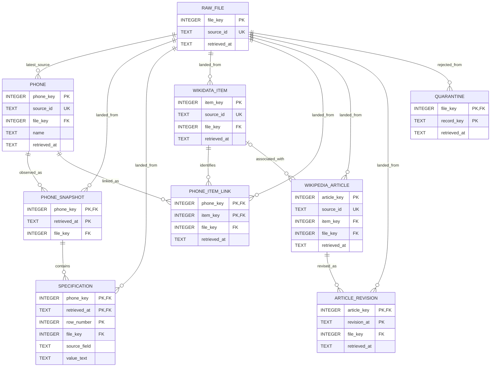

# Cellphone Launch Prices and Specifications

## The question

This project aims to explore the connection between smartphones’ original launch prices (MSRP) and their technical specifications, as well as how this connection has evolved over the years. By combining pricing data with hardware specifications, we will compare features such as RAM and storage capacity relative to launch prices across different years and manufacturers. We will also investigate which hardware characteristics have the strongest relationship with MSRP and assess their ability to predict launch prices. To ensure fair comparisons, we will consider the original currency, market, and storage configuration of each device.

## Sources

- GSMArena phone catalog — model and specification source, one page per model.
- Wikipedia articles — release history and supporting information.
- Wikidata entities — structured identities and links between the other sources.

See [source cards](docs/sources.md) for provenance, access notes and known issues. Raw responses are excluded from Git because GSMArena's terms restrict redistribution; running the ingestion regenerates them.

Attribution:

- Phone specifications are from [GSMArena.com](https://www.gsmarena.com/), copyright Arena Kom OOD.
- Wikipedia text is by Wikipedia contributors, available under [CC BY-SA 4.0](https://creativecommons.org/licenses/by-sa/4.0/).
- [Wikidata](https://www.wikidata.org/) data is available under CC0 1.0.

## Setup and run

Requires Python 3.10 or later. From the repository root:

```sh
python -m venv venv
# PowerShell: use the interpreter directly; activation is optional.
.\venv\Scripts\python.exe -m pip install -r requirements.txt
```

On Linux or macOS the interpreter is `venv/bin/python`.

Set `PHONE_DATA_USER_AGENT` to a descriptive value with a real contact address as shown in `.env.example` (for example, in PowerShell: `$env:PHONE_DATA_USER_AGENT = 'PhoneLaunchPricesStudentProject/0.1 (contact: name@example.com)'`). Copy `.env.example` to `.env` and replace the placeholder contact; the script refuses to start with the placeholder. The script automatically loads `.env` from the repository root; existing process environment variables take precedence. No API key is needed for any source. Then run from the repository root:

```sh
.\venv\Scripts\python.exe src/ingest.py --max-brands 1 --max-models 2 --max-wikidata-pages 1 --wikidata-page-size 5 --max-wikipedia-articles 2
```

This trial enumerates one brand, downloads details for two models, samples five Wikidata rows and requests at most two Wikipedia articles. It takes about a minute and ends with a summary:

```
Fetched 2 GSMArena model details
Discovered 5 Wikidata entities; requested 2 Wikipedia articles
Raw responses saved: gsmarena=6, wikidata=1, wikipedia=1
```

Inspect the run summary and raw responses, then run `python src/ingest.py` for the full collection. GSMArena serves about 7.5 pages a minute to one address, so its 15,000 pages take about 34 hours; Wikidata and Wikipedia take a few minutes. The discovered URLs are checkpointed in `data/discovery/`, separate from raw source responses. `PHONE_DATA_DELAY_SECONDS`, `PHONE_DATA_TIMEOUT_SECONDS` and `PHONE_DATA_RETRIES` are optional environment settings. Each source pipeline stops on an error and is listed on a `FAILED:` line; the other pipeline is still attempted and reports how many original responses were saved; each later run adds files rather than overwriting them.

Each response is saved unchanged as `data/raw/<source>/<UTC timestamp>_<number>.html` or `.json`, next to a `.meta.json` file with the address, the retrieval time and the size.

To retry GSMArena after a partial run, use `--sources gsmarena --resume`.
This reuses saved catalog and model responses, including mobile redirects, and
fetches missing pages. Server messages requesting a slowdown are never reused;
they trigger a 60-second wait and retry, even when returned with HTTP 200.
Keep `PHONE_DATA_DELAY_SECONDS=8`, as in `.env.example`: a shorter delay only
triggers the slowdown message. When Wikidata results are already saved
(`--sources wikidata`), the models they link to are fetched first.

On Linux, `scripts/crawl_gsmarena.sh` repeats the resume command after a rate-limit stop, and `scripts/crawl_status.py` shows how far a crawl is.

GSMArena's terms restrict redistribution, so never commit `data/raw/`. Read the terms before a full run: they allow personal, informational, non-commercial use only. The code keeps to the pace the site allows and does not bypass access controls. The model catalog includes tablets and watches; classification belongs in later milestones.

To run the tests:

```sh
.\venv\Scripts\python.exe -m unittest discover -s tests
```

## Structure

- `src/ingest.py` — ingestion entry point.
- `tests/test_ingest.py` — tests of the ingestion script; they make no network requests.
- `scripts/` — helpers for the long GSMArena crawl.
- `data/raw/` — timestamped original responses, kept locally.
- `data/discovery/` — local model URL inventories from catalog traversal.
- `docs/sources.md` — data source and licence cards.
- `requirements.txt` — packages the script imports.
- `.env.example` — configuration template; `.env` is ignored.
- `data.pyproj`, `data.slnx` — Visual Studio project files.

## M2: build the database offline

M2 reads the landed files and their `.meta.json` sidecars. It never fetches
anything. The available team extract is under `data/raw/gsmarena/`; keep the
Wikidata and Wikipedia responses under `data/raw/wikidata/` and
`data/raw/wikipedia/`. The default command requires all three sources and fails
if one is missing. Do not mix raw responses with generated database files.

From the repository root, using Python 3.10+ with SQLite 3.37+:

```powershell
python -m venv .venv
.\.venv\Scripts\python.exe -m pip install -r requirements.txt
.\.venv\Scripts\python.exe src/profile_keys.py > docs/m2/key-audit.json
.\.venv\Scripts\python.exe src/load.py
.\.venv\Scripts\python.exe src/load.py
.\.venv\Scripts\python.exe src/checks.py
.\.venv\Scripts\python.exe src/report.py
.\.venv\Scripts\python.exe -m unittest discover -s tests -q
```

On Linux/macOS use `.venv/bin/python`. The derived database is
`data/phones.db`, ignored by Git. `--db PATH` and `--raw PATH` are available on
`load.py` and `checks.py`; the raw root must contain the three source folders.
The loader creates a missing database directory and applies `sql/schema.sql`
inside the same transaction as the data. An empty or incomplete raw folder is
an error, not a successful zero-row load.

The Visual Studio startup target is now the offline loader, with no crawl
arguments. Select an interpreter with the dependencies above when running it
through Visual Studio.

### Data model



All nine tables are `STRICT`. All key columns explicitly declare `NOT NULL`.
Every entity has an integer surrogate primary key and a retained
`NOT NULL UNIQUE` source identifier. Every relationship has a declared foreign
key. `src/db.py:connect()` is the single connection function and immediately
enables foreign keys. Every row retains `retrieved_at` and its landed-file
reference; `raw_file` retains the relative path, original URL, byte count, and
SHA-256 of the original bytes.

### Table grains

| Table | One row means | Natural/event key |
| --- | --- | --- |
| `raw_file` | One immutable landed response file | Relative path within the raw root |
| `phone` | One GSMArena catalog model, with its latest retrieved name and URL | Numeric GSMArena model ID, retained as text |
| `phone_snapshot` | One retrieved observation of one model | Model key + retrieval timestamp |
| `specification` | One specification cell in one model snapshot, including unlabeled continuation cells | Model key + retrieval timestamp + source row ordinal |
| `wikidata_item` | One Wikidata item, possibly describing a family | Wikidata QID |
| `phone_item_link` | One observed association of a model and an item | Model key + item key |
| `wikipedia_article` | One English Wikipedia page, including redirect pages | Wikipedia page ID, retained as text |
| `article_revision` | One article revision identified by its source revision timestamp | Article key + revision timestamp |
| `quarantine` | One rejected record in a landed response | File key + record position or response marker |

### Keys: evidence from the landed data

`src/profile_keys.py` tests source IDs, repeated-copy identity, event keys and
references before any database is created. Reproduce the measurements with the
command above; the output is saved in `docs/m2/key-audit.json`.

- 14,882 model responses contain **14,877 distinct GSMArena IDs**: five are
  extra responses for previously fetched IDs, including the unusable slowdown
  body. Catalog pages are excluded before testing model identity.
  Slugs and phone names are not keys. The URL's numeric model ID survives a
  rename; repeated copies are compared for name changes in the audit.
- The 2,576 Wikidata rows have 2,576 distinct `(QID, GSMArena ID)` pairs,
  covering 2,539 items and 2,552 model IDs. **37 items link to multiple models;
  24 model IDs link to multiple items.** A one-to-one join would lose evidence.
- Ten Wikidata phone references do not resolve to a landed GSMArena model:
  `47, 48, 49, 50, 1827, 2424, 8710, 8930, 10756, 13958`.
- The 1,806 Wikipedia page records have 1,806 distinct page IDs. Their provided
  Wikidata QIDs resolve to landed items. A page without a provided QID is
  retained with a NULL item reference; we do not invent one from its title.
- A specification's ordinal is assigned within its snapshot. Repeated labels
  and unlabeled continuation cells remain distinct, rather than silently
  overwriting each other. Specification rows reference the complete composite
  snapshot key.

### Loading decisions

**Deduplication and change over time.** Current entity attributes use type 1:
the greatest normalized `retrieved_at` wins. On a timestamp tie the greatest
relative source path wins, consistently across incremental and fresh loads.
Existing surrogate keys remain stable through `ON CONFLICT ... DO UPDATE`.
Model snapshots and article revisions retain their history. Links describe
observed associations; absence from a later query page does not imply deletion.
An article revision is keyed by page ID and revision timestamp because M1 did
not request revision IDs. If a future source supplies two revisions of one
page with the same timestamp, this key must be revisited.

**Missing values and types.** Empty specification cells become NULL and are
counted. Other specification values remain source text, including `n/a`,
`No`, `-`, `About 140 EUR`, and multiple storage/RAM variants. An absent field
means no specification row. None of these means numeric zero. M2 does not
extract monetary amounts, infer launch MSRP, convert units, classify devices,
or repair wikitext. Byte counts and row ordinals are validated integers; source
IDs must have their documented formats. All timestamps (including revision
timestamps) become fixed-width ISO 8601 UTC TEXT with six fractional digits,
e.g. `2026-10-09T13:02:22.074113Z`. A timestamp without a timezone is rejected.

**Unknown references and quarantine.** The loader establishes GSMArena
models, then Wikidata items/links, then Wikipedia articles/revisions. Unknown
model links, unknown article QIDs, missing article content, malformed individual
records, and the legacy slowdown response go into quarantine with their payload,
reason, source file and retrieval timestamp. A valid Wikidata item is still
stored when its GSMArena link is unresolved. Quarantine is re-evaluated on each
load, so a later landed parent can resolve it. Nothing fabricates a parent.

**HTML encoding.** Some pages declare UTF-8 but contain invalid byte sequences
in visitor comments outside the specification data. These files/bytes are
counted. Parsing uses a reversible surrogate escape internally; if any model
name or specification field contains such a byte, the whole model response is
quarantined. We do not insert replacement characters or guess another encoding.
Invalid bytes confined to unmodeled page content do not reject valid model data.

**Atomicity and damaged files.** The entire load, including schema creation,
is one explicit transaction. Invalid/missing metadata, a missing response body,
byte-count mismatch, malformed JSON response, or changed previously loaded raw
bytes/metadata aborts the whole run. Individual record problems with usable
provenance are quarantined and counted. The distinction allows a completed
load with known source issues while making file corruption a visible failure.
There is no current-time load timestamp or run ledger to change on a repeat
load. Files are not deleted or edited by M2.

### Known issues and analysis limits

The catalog includes tablets, watches and older feature phones. Wikipedia
redirect bodies are preserved, and some articles represent whole families.
GSMArena prices are often estimates or current offers, so their presence does
not establish an original launch price. Numeric specifications, launch-price
evidence, regional variants, classification and outliers belong in M3. The
raw source remains the authority if parsing loses presentation detail.

Catalog/index pages remain in `raw_file` as provenance and are counted as
catalog files; they are not model records. The legacy 49-byte slowdown body is
quarantined. Four additional valid model observations remain in
`phone_snapshot`; the fifth extra response is the quarantined slowdown body.

### Analytical query

Question: how much of the catalog has both price text and a Wikidata link?
This identifies the evidence coverage available for the launch-price project.
The result grain is one row per pair of presence flags. Each phone contributes
exactly once; correlated `EXISTS` avoids multiplying phones through the
many-to-many item links or multiple specification rows. Query file:
`sql/queries/price_coverage.sql`.

```sql
WITH coverage AS (
    SELECT
        EXISTS (SELECT 1 FROM specification s
                WHERE s.phone_key=p.phone_key AND s.retrieved_at=p.retrieved_at
                  AND s.source_field='price' AND s.value_text IS NOT NULL) AS has_price_text,
        EXISTS (SELECT 1 FROM phone_item_link l
                WHERE l.phone_key=p.phone_key) AS has_wikidata_link
    FROM phone p
)
SELECT has_price_text, has_wikidata_link, COUNT(*) AS models
FROM coverage
GROUP BY has_price_text, has_wikidata_link
ORDER BY has_price_text, has_wikidata_link;
```

Measured output from the landed data:

| has_price_text | has_wikidata_link | models |
| --- | --- | ---: |
| 0 | 0 | 4,105 |
| 0 | 1 | 420 |
| 1 | 0 | 8,230 |
| 1 | 1 | 2,122 |

The groups sum to 14,877 models. A Wikidata link exists for 2,542 models, and
2,122 of those have price text. These are coverage counts, not verified MSRP.

The built database has 14,881 valid model snapshots, 598,283 specification cells,
2,539 Wikidata items, 2,566 model-item links, 1,806 articles and 1,806 revisions.
Quarantine contains 11 records: ten unknown phone references and one slowdown
response. 12,045 empty specification cells became NULL. One page contains three
invalid UTF-8 bytes confined to unmodeled content. The second full load left
every table's row count unchanged, with zero new entities.

Logs, the key audit, regression results and query output are saved in
[`docs/m2/`](docs/m2/README.md). `src/checks.py` uses a read-only source connection and SQLite backup
to make a temporary copy. It tests duplicate natural keys, orphan events, NULL
event keys, wrong numeric types, identical full contents after two loads, and
rollback after a new model is inserted and a later JSON file is broken. It also
checks STRICT tables and foreign keys. It never loads into the real database.

Validation on the complete landed dataset passed all six required checks plus
the STRICT-table and foreign-key checks. Idempotence compares every table's
complete row contents, not only counts; the failed-load check does the same.
All 26 offline regression tests also pass. An independent 100-page sample
matched BeautifulSoup on all 4,118 specification cells' field IDs and text.

For submission, the team must review the results, make its own meaningful
commits, push the reviewed state and the `m2` tag, and upload the derived
database and load/check outputs to the course system. Raw responses and the
database remain excluded from Git.

## Status

M2 — schema and load complete. Full-data checks and 26 regression tests pass.

## Team

- Oğuzhan Karacan — [NevermindExpress](https://github.com/NevermindExpress)
- Osman Yiğit Doğan — [se-230717001](https://github.com/se-230717001)
- Onur Atıcı — [se-240717002](https://github.com/se-240717002)
