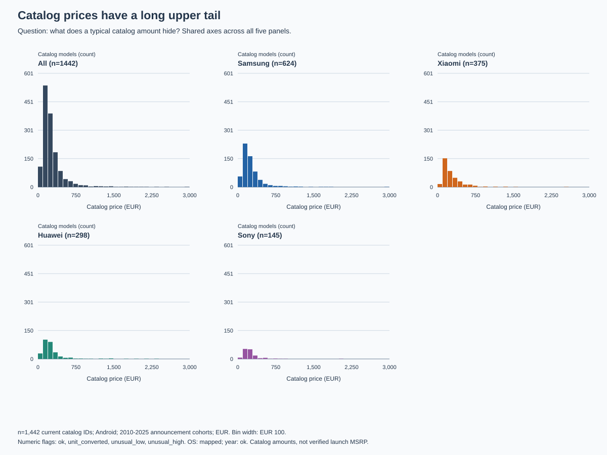
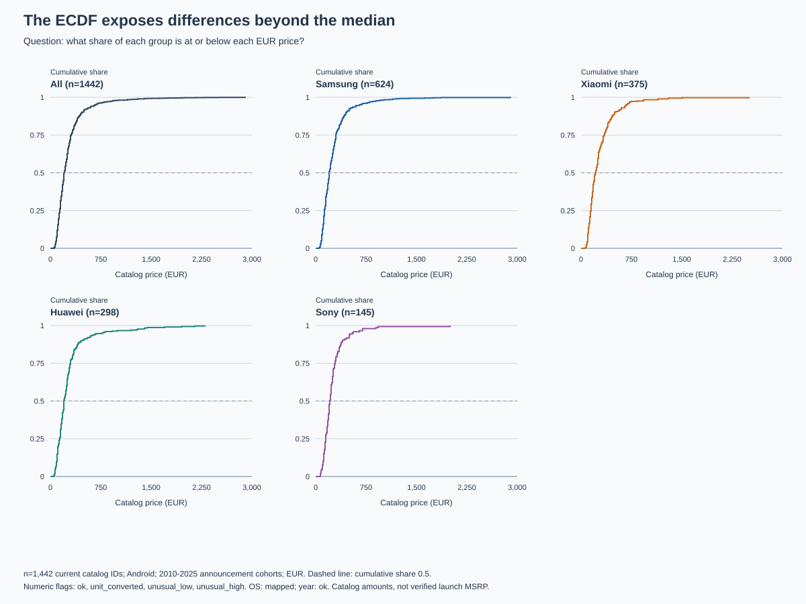
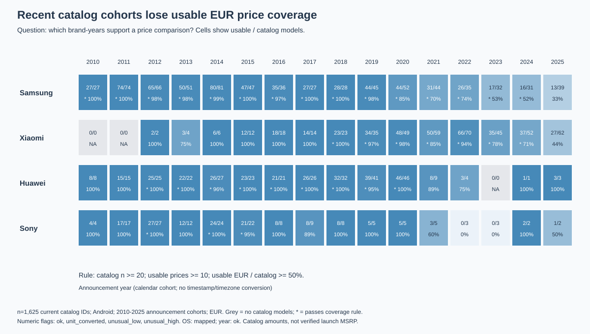
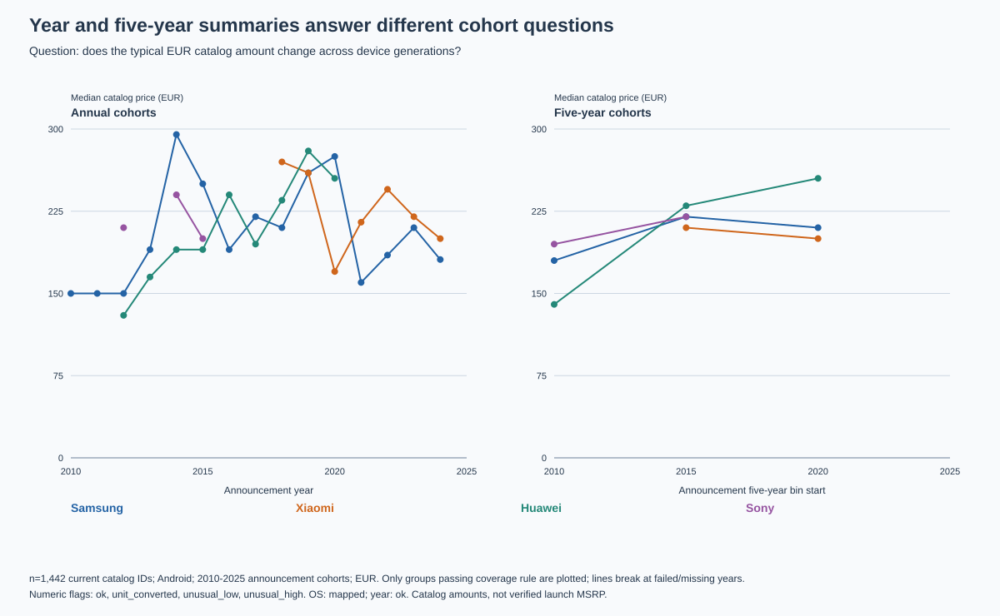
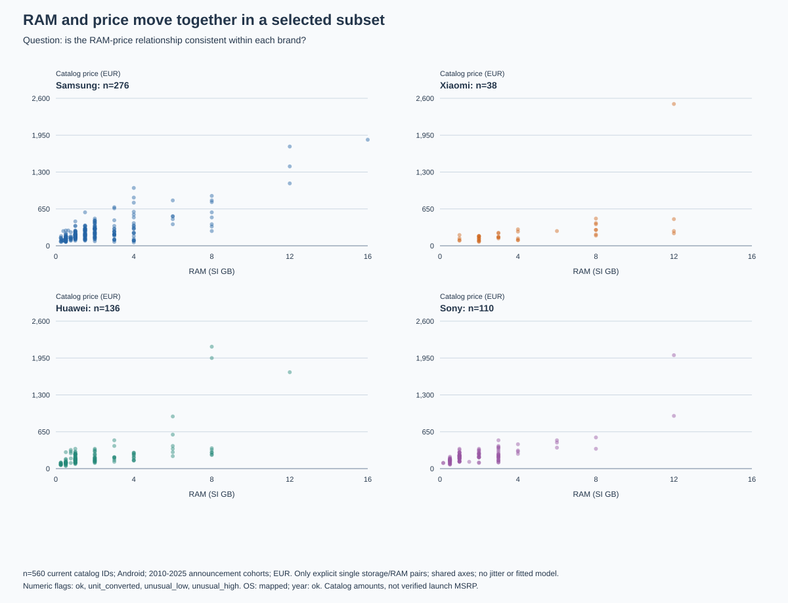
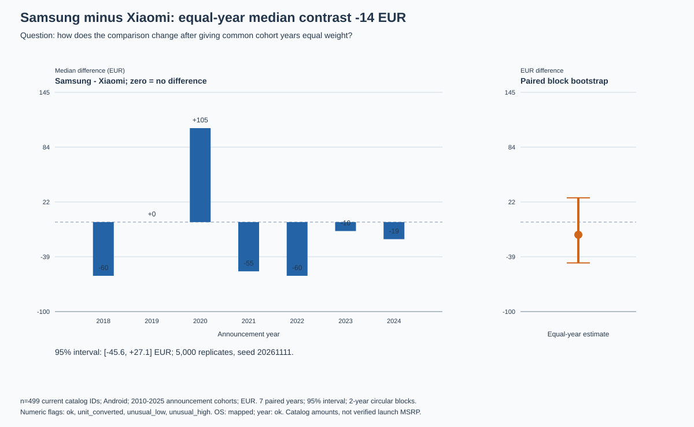

# Exploratory Analysis — Cellphone Catalog Prices and Specifications

## 1. Summary

The project asks how smartphone launch prices relate to hardware and how that relationship changes across manufacturers and years, but the current extract supports only a narrower catalog-price exploration. We examine 1,625 Android catalog entries from four named brands, announced in 2010–2025, of which 1,442 have a usable EUR amount; this is not a validated smartphone-only cohort. Typical priced entries have a median of EUR 210.00, while brand medians range from EUR 200 to EUR 220. RAM and price are positively related in 560 complete pairs (Pearson 0.674, Spearman 0.596), but configuration availability differs sharply between brands. The Samsung-minus-Xiaomi equal-year median contrast is EUR -14.15, with an exploratory 95% block-bootstrap interval of [-45.58, +27.14], so these data do not establish a stable brand premium. Better launch-price evidence, device classification, configuration extraction, or different cohort coverage could change these results; no additional M3 parser correction or feedback resolution is claimed in this milestone.

## 2. Raw versus cleaned

Question: what mean EUR catalog amount would a simple raw query report, and what changes when the cleaned layer is used? The M2 baseline selects current observations, removes the literal `About`/`EUR` wrapper, and applies SQLite's numeric cast without interpreting other monetary representations. It has no quality flags because M2 contains source text. The cleaned query accepts only mapped Android OS, an `ok` announcement year, explicit EUR currency, and the primary numeric flags listed below. All values are bound parameters, including lists passed through `json_each`; neither query interpolates values into SQL.

| brand | raw_n | raw_mean_EUR | clean_n | clean_mean_EUR | difference_EUR |
|---|---|---|---|---|---|
| Huawei | 298 | 283.054 | 298 | 283.054 | 0.000 |
| Samsung | 619 | 266.640 | 624 | 266.177 | -0.462 |
| Sony | 144 | 252.014 | 145 | 256.455 | 4.441 |
| Xiaomi | 360 | 284.861 | 375 | 283.154 | -1.707 |

Cleaning changes the eligible monetary representations and counts: the naive `About … EUR` baseline omits explicit euro-symbol amounts that M3 can parse. Huawei's result is unchanged, while Samsung, Sony, and Xiaomi change because the cleaned query includes additional supported EUR observations; this is a representation/cohort change, not a measured correction to a true launch price. The raw query deliberately exposes its limited grammar rather than treating unsupported source text as zero or silently using M3 values in a supposedly raw calculation.

Both queries follow. Parameters are recorded in the first notebook code cell and in `docs/m4/results.json`: brands Samsung/Xiaomi/Huawei/Sony, Android, EUR, years 2010–2025; raw patterns `Android%` and `About % EUR`; primary flags `ok`, `unit_converted`, `unusual_low`, `unusual_high`.

```sql
-- M2-only baseline: latest rows, raw Android prefix, raw year cast, no flags.
-- Deliberately naive SQLite CAST of About ... EUR; no cleaning or variants.
WITH models AS (
 SELECT p.phone_key,substr(p.name,1,instr(p.name || ' ',' ')-1) AS brand,
 MAX(CASE WHEN s.source_field='os' THEN s.value_text END) AS os,
 MAX(CASE WHEN s.source_field='year' THEN CAST(s.value_text AS INTEGER) END) AS year,
 MAX(CASE WHEN s.source_field='price' AND s.value_text LIKE :price_pattern
 THEN CAST(replace(replace(s.value_text,'About ',''),' EUR','') AS REAL) END) AS price
 FROM phone p JOIN specification s ON s.phone_key=p.phone_key AND s.retrieved_at=p.retrieved_at
 GROUP BY p.phone_key,p.name
)
SELECT brand,COUNT(*) AS catalog_n,COUNT(price) AS n,AVG(price) AS mean_price
FROM models WHERE os LIKE :os_pattern AND year BETWEEN :start AND :end
 AND brand IN (SELECT value FROM json_each(:brands)) GROUP BY brand ORDER BY brand;
```

```sql
-- One row per current canonical catalog model. Every numeric field uses :flags;
-- year requires ok, OS requires mapped. No memory variant is selected.
WITH cells AS (
 SELECT p.phone_key,p.name,p.retrieved_at,
        substr(p.name,1,instr(p.name || ' ',' ')-1) AS brand,
        s.source_field,s.number,s.ram_gb,s.unit,s.number_flag,s.category,s.category_flag
 FROM phone p JOIN specification_current s USING(phone_key)
 WHERE s.resolved_phone_key=p.phone_key
), models AS (
 SELECT phone_key,name,brand,retrieved_at,
 MAX(CASE WHEN source_field='os' AND category_flag='mapped' THEN category END) AS os,
 MAX(CASE WHEN source_field='year' AND number_flag='ok' THEN CAST(number AS INTEGER) END) AS year,
 MAX(CASE WHEN source_field='price' AND unit=:currency AND number_flag IN (SELECT value FROM json_each(:flags)) THEN number END) AS price,
 MAX(CASE WHEN source_field='internalmemory' AND number_flag IN (SELECT value FROM json_each(:flags)) THEN ram_gb END) AS ram,
 MAX(CASE WHEN source_field='internalmemory' AND number_flag IN (SELECT value FROM json_each(:flags)) THEN number END) AS storage,
 MAX(CASE WHEN source_field='displaysize' AND unit='inch' AND number_flag IN (SELECT value FROM json_each(:flags)) THEN number END) AS display_in,
 MAX(CASE WHEN source_field='price' THEN 1 ELSE 0 END) AS price_present,
 MAX(CASE WHEN source_field='price' THEN number_flag END) AS price_flag
 FROM cells GROUP BY phone_key,name,brand,retrieved_at
)
SELECT * FROM models WHERE os=:os AND year BETWEEN :start AND :end
 AND brand IN (SELECT value FROM json_each(:brands)) ORDER BY phone_key;
```

The cleaned query returns the reduced model-grain layer, on which the notebook calculates the mean, median and percentiles. It does not export the full specification-cell table into Python. Additional checks reject repeated analytical fields and unreviewed identity mappings before a result is accepted.

## 3. The question and its summary

The operational question is: among these four Android brand cohorts, how do typical EUR catalog amounts differ, and how does RAM relate to price where a single configuration is available? Median price answers the typical-priced-model question and limits the influence of the expensive tail. Mean price answers the different question of average catalog amount per priced model; the 95th percentile describes the upper tail. None is sales-weighted, and one source model ID contributes once regardless of the number of source links or historical snapshots.

Primary-filter brand summaries are below. Their coverage rule requires at least 20 catalog models, 10 usable EUR prices, and 50% usable-price coverage. All four brand-wide groups pass. The overall descriptive distribution pools their priced entries and retains the same primary flags; it is not a price estimate for the unobserved models.

| brand | catalog_n | price_n | mean | median | p95 | eligible |
|---|---|---|---|---|---|---|
| Huawei | 303 | 298 | 283.054 | 200.000 | 764.500 | yes |
| Samsung | 715 | 624 | 266.177 | 200.000 | 658.500 | yes |
| Sony | 156 | 145 | 256.455 | 210.000 | 542.000 | yes |
| Xiaomi | 451 | 375 | 283.154 | 220.000 | 673.000 | yes |

The rankings differ. Xiaomi leads by median (220), Sony follows (210), and Huawei/Samsung tie (200); Xiaomi also leads by mean, narrowly followed by Huawei, then Samsung and Sony. Huawei has the largest p95. These are compatible answers: a group can have a typical low-to-middle amount and a heavier premium tail. A ranking without naming its summary would hide that distinction.

## 4. What the data is made of

### Shape





Each figure uses current IDs, mapped Android, `ok` year, 2010–2025 announcement cohorts, EUR amounts, and primary numeric flags. Panel-specific n is in its title; total priced n is 1,442. The histogram starts at zero and retains the full tail through EUR 2,900. All small multiples share scales, even where this makes a small brand's bars less prominent. The ECDF is independent of histogram bins and makes cumulative shares and medians directly readable.

| width | nonempty_bins | peak_bin_n | upper | n |
|---|---|---|---|---|
| 50 | 37 | 270 | 2,900.000 | 1442 |
| 100 | 25 | 537 | 2,900.000 | 1442 |
| 200 | 14 | 645 | 2,900.000 | 1442 |

Widths of EUR 50, 100, and 200 were tried. EUR 50 produces a more fragmented view of rounded catalog values; EUR 200 merges much of the affordable range into a few large bins. EUR 100 keeps useful affordable/premium separation without implying precise price modes. The chosen width is in natural currency units and is fixed across groups. The long right tail and rounded-value concentrations support using the median; neither the histogram nor the ECDF establishes a distinct latent market segment.

### Coverage and denominators



The coverage denominator is all landed catalog IDs satisfying the stated OS, brand and valid-year cohort, including IDs without a usable price. It is not the unknown count of every device the manufacturer released. At entity level, price availability is one usable observation out of one current snapshot, or zero out of one. These indicators are summed by brand and year below. `joint_n` requires both a price and an explicit single storage/RAM pair; ambiguous configurations remain excluded rather than selecting their cheapest or largest variant.

| brand | catalog_n | price_n | joint_n | price_coverage | ram_price_coverage |
|---|---|---|---|---|---|
| Huawei | 303 | 298 | 136 | 0.983 | 0.449 |
| Samsung | 715 | 624 | 276 | 0.873 | 0.386 |
| Sony | 156 | 145 | 110 | 0.929 | 0.705 |
| Xiaomi | 451 | 375 | 38 | 0.831 | 0.084 |

| brand | year | catalog_n | price_n | joint_n | price_coverage | eligible |
|---|---|---|---|---|---|---|
| Huawei | 2010 | 8 | 8 | 4 | 1.000 | no |
| Huawei | 2011 | 15 | 15 | 12 | 1.000 | no |
| Huawei | 2012 | 25 | 25 | 19 | 1.000 | yes |
| Huawei | 2013 | 22 | 22 | 19 | 1.000 | yes |
| Huawei | 2014 | 27 | 26 | 21 | 0.963 | yes |
| Huawei | 2015 | 23 | 23 | 14 | 1.000 | yes |
| Huawei | 2016 | 21 | 21 | 7 | 1.000 | yes |
| Huawei | 2017 | 26 | 26 | 12 | 1.000 | yes |
| Huawei | 2018 | 32 | 32 | 6 | 1.000 | yes |
| Huawei | 2019 | 41 | 39 | 10 | 0.951 | yes |
| Huawei | 2020 | 46 | 46 | 10 | 1.000 | yes |
| Huawei | 2021 | 9 | 8 | 2 | 0.889 | no |
| Huawei | 2022 | 4 | 3 | 0 | 0.750 | no |
| Huawei | 2024 | 1 | 1 | 0 | 1.000 | no |
| Huawei | 2025 | 3 | 3 | 0 | 1.000 | no |
| Samsung | 2010 | 27 | 27 | 12 | 1.000 | yes |
| Samsung | 2011 | 74 | 74 | 34 | 1.000 | yes |
| Samsung | 2012 | 66 | 65 | 36 | 0.985 | yes |
| Samsung | 2013 | 51 | 50 | 26 | 0.980 | yes |
| Samsung | 2014 | 81 | 80 | 53 | 0.988 | yes |
| Samsung | 2015 | 47 | 47 | 27 | 1.000 | yes |
| Samsung | 2016 | 36 | 35 | 24 | 0.972 | yes |
| Samsung | 2017 | 27 | 27 | 13 | 1.000 | yes |
| Samsung | 2018 | 28 | 28 | 7 | 1.000 | yes |
| Samsung | 2019 | 45 | 44 | 12 | 0.978 | yes |
| Samsung | 2020 | 52 | 44 | 12 | 0.846 | yes |
| Samsung | 2021 | 44 | 31 | 6 | 0.705 | yes |
| Samsung | 2022 | 35 | 26 | 3 | 0.743 | yes |
| Samsung | 2023 | 32 | 17 | 4 | 0.531 | yes |
| Samsung | 2024 | 31 | 16 | 6 | 0.516 | yes |
| Samsung | 2025 | 39 | 13 | 1 | 0.333 | no |
| Sony | 2010 | 4 | 4 | 1 | 1.000 | no |
| Sony | 2011 | 17 | 17 | 12 | 1.000 | no |
| Sony | 2012 | 27 | 27 | 25 | 1.000 | yes |
| Sony | 2013 | 12 | 12 | 10 | 1.000 | no |
| Sony | 2014 | 24 | 24 | 21 | 1.000 | yes |
| Sony | 2015 | 22 | 21 | 19 | 0.955 | yes |
| Sony | 2016 | 8 | 8 | 5 | 1.000 | no |
| Sony | 2017 | 9 | 8 | 5 | 0.889 | no |
| Sony | 2018 | 8 | 8 | 4 | 1.000 | no |
| Sony | 2019 | 5 | 5 | 2 | 1.000 | no |
| Sony | 2020 | 5 | 5 | 2 | 1.000 | no |
| Sony | 2021 | 5 | 3 | 2 | 0.600 | no |
| Sony | 2022 | 3 | 0 | 0 | 0.000 | no |
| Sony | 2023 | 3 | 0 | 0 | 0.000 | no |
| Sony | 2024 | 2 | 2 | 1 | 1.000 | no |
| Sony | 2025 | 2 | 1 | 1 | 0.500 | no |
| Xiaomi | 2012 | 2 | 2 | 1 | 1.000 | no |
| Xiaomi | 2013 | 4 | 3 | 1 | 0.750 | no |
| Xiaomi | 2014 | 6 | 6 | 3 | 1.000 | no |
| Xiaomi | 2015 | 12 | 12 | 5 | 1.000 | no |
| Xiaomi | 2016 | 18 | 18 | 6 | 1.000 | no |
| Xiaomi | 2017 | 14 | 14 | 3 | 1.000 | no |
| Xiaomi | 2018 | 23 | 23 | 1 | 1.000 | yes |
| Xiaomi | 2019 | 35 | 34 | 2 | 0.971 | yes |
| Xiaomi | 2020 | 49 | 48 | 2 | 0.980 | yes |
| Xiaomi | 2021 | 59 | 50 | 2 | 0.847 | yes |
| Xiaomi | 2022 | 70 | 66 | 2 | 0.943 | yes |
| Xiaomi | 2023 | 45 | 35 | 4 | 0.778 | yes |
| Xiaomi | 2024 | 52 | 37 | 4 | 0.712 | yes |
| Xiaomi | 2025 | 62 | 27 | 2 | 0.435 | no |

The annual rule is the same 20 catalog / 10 usable / 50% threshold as the brand-wide rule. Twenty limits very small catalog cohorts; ten avoids reporting a median from only a handful of prices; half-coverage prevents a small observed minority defining a cohort's typical amount. These are explicit pragmatic screens, not calibrated representativeness guarantees. 34 of 61 observed brand-years pass. Zero-model cells in the heatmap are missing groups, not zero-price products. Failed groups remain in the audit table but are gaps in the annual figure.

The equal-year Samsung-minus-Xiaomi median contrast is EUR -14.15 across 7 supported common years with the rule. Removing it admits 2015–2025 and gives EUR +2.81 across 11 years. Its direction changes because the admitted cohort mixture changes; this is a sensitivity of the target set, not proof of a causal reversal.

### Flag sensitivity

The primary filter retains unusual positive measurements because a premium or rugged product is not automatically a data error. The strict filter uses only `ok` and `unit_converted` for every numeric field. OS and year requirements stay unchanged, and no currency is converted or pooled.

| brand | primary_n | primary_mean | primary_median | strict_n | strict_mean | strict_median |
|---|---|---|---|---|---|---|
| Huawei | 298 | 283.054 | 200.000 | 274 | 212.117 | 200.000 |
| Samsung | 624 | 266.177 | 200.000 | 584 | 219.255 | 200.000 |
| Sony | 145 | 256.455 | 210.000 | 139 | 225.252 | 210.000 |
| Xiaomi | 375 | 283.154 | 220.000 | 344 | 231.497 | 200.000 |

Strict filtering reduces every mean and makes Xiaomi's median tie Huawei and Samsung. Its effect is larger on upper-tail-sensitive summaries than on most medians. We report primary results because M3 unusual flags are descriptive IQR fences, not confirmed invalidity; the strict results show how removing valid premium products can alter the question.

## 5. Announcement cohorts and the clock



These are device-generation cohorts, not repeated observations of the same price over time. Announcement year is a source calendar year; no precise announcement timestamp or timezone is available to convert. Applying `tz_convert` to an invented January timestamp would manufacture information. Retrieval timestamps are genuinely UTC and span 2026-10-09T13:12:26.109302Z to 2026-10-11T00:13:23.874785Z; they document collection only. Grouping that three-day collection by local hour would answer a crawler-scheduling question.

The 2026 cohort is excluded because collection occurred before year end. At the 2010 left edge: Samsung 27/27 usable prices (passes the rule), Xiaomi no retained entries, Huawei 8/8 usable prices (fails the rule), Sony 4/4 usable prices (fails the rule). At the 2025 right edge: Samsung 13/39 usable prices (fails the rule), Xiaomi 27/62 usable prices (fails the rule), Huawei 3/3 usable prices (fails the rule), Sony 1/2 usable prices (fails the rule). Passing coverage cannot establish a complete historical catalog. The notebook prints both edge audits, and this report retains the complete annual table.

The two scales are annual and five-year announcement cohorts; the latter group years by floor(year/5). Both use the same flags and coverage rule. Broader bins provide more support but can hide individual-year changes. The brand-within-year hierarchy supplies a second grouping rather than an invented hourly timeline. Holidays, launch-day effects, and day-of-week seasonality cannot be assessed from year-only dates; they are explicitly untestable here, not checked and found absent.

## 6. Relationships



The scatter is written before coefficients are computed. It shows discrete RAM levels, substantial vertical price spread, and a few expensive observations, making Spearman's rank association a useful main description of the monotone pattern. Pearson remains informative about the numeric linear relationship but is sensitive to extremes. Both are reported on identical pairs; neither says that adding RAM causes a particular price increase.

| check | n | pearson | spearman |
|---|---|---|---|
| All complete pairs | 560 | 0.674 | 0.596 |
| Remove marginal top 1% | 554 | 0.624 | 0.582 |
| Within brand-year residuals | 453 | 0.665 | 0.695 |

| brand | n | pearson | spearman |
|---|---|---|---|
| Samsung | 276 | 0.792 | 0.612 |
| Xiaomi | 38 | 0.521 | 0.719 |
| Huawei | 136 | 0.628 | 0.677 |
| Sony | 110 | 0.776 | 0.629 |

Removing rows above the marginal 99th percentiles of RAM and price removes 6 of 560 pairs. The cutoffs are 12.00 GB and EUR 1720.50; observations equal to a cutoff remain. Pearson falls from 0.674 to 0.624, while Spearman changes from 0.596 to 0.582. The association survives this check, although the sensitivity does not rule out every influential case.

| omitted_brand | n | pearson | spearman |
|---|---|---|---|
| Samsung | 284 | 0.603 | 0.595 |
| Xiaomi | 522 | 0.731 | 0.627 |
| Huawei | 424 | 0.694 | 0.568 |
| Sony | 450 | 0.657 | 0.595 |

No single omitted brand eliminates the positive pooled association. To check shared generation and brand structure, RAM and price are demeaned within brand-year cells containing at least ten complete pairs; 453 pairs remain. Their residual association is still positive. The notebook also prints every supported within-cell coefficient; residual Spearman is a sensitivity on residual ranks, not a formal partial Spearman estimate. These checks address observed group structure while leaving unmeasured device type, configuration selection, and price provenance unresolved.

## 7. The comparison



Samsung/Xiaomi was selected for substantive relevance and common-cohort support before inspecting the price contrasts. Its primary estimand is the mean of annual Samsung-minus-Xiaomi medians, giving each eligible common year equal weight. It is not the difference between the medians of all individual phones. Annual strata show both model counts and direction:

| year | a_n | b_n | a_median | b_median | difference |
|---|---|---|---|---|---|
| 2018 | 28 | 23 | 210.000 | 270.000 | -60.000 |
| 2019 | 44 | 34 | 260.000 | 260.000 | 0.000 |
| 2020 | 44 | 48 | 275.000 | 170.000 | 105.000 |
| 2021 | 31 | 50 | 160.000 | 215.000 | -55.000 |
| 2022 | 26 | 66 | 185.000 | 245.000 | -60.000 |
| 2023 | 17 | 35 | 210.000 | 220.000 | -10.000 |
| 2024 | 16 | 37 | 180.920 | 200.000 | -19.080 |

The estimate is EUR -14.15; the 95% percentile interval is [-45.58, +27.14]. We resample paired annual contrasts in two-year circular moving blocks, retain 7 years per replicate, and use 5,000 replicates with seed 20261111. Pairing preserves common cohort conditions and blocks retain some adjacent-year dependence; circular wrapping is a bootstrap convention, not an assertion that the endpoints are historically adjacent. An independent-year sensitivity interval is [-46.88, +31.69]. Seven cohort years provide weak support for precise uncertainty, and neither interval covers selection or measurement bias.

The full-cohort pooled median gap is EUR -20.00 (Samsung n=624, Xiaomi n=375). Restricting to common supported years gives EUR -10.00 (n=206 and 293). Equal weighting gives the estimate above. The counts show different cohort mixtures; annual differences include both signs. There is no uniform within-year reversal establishing Simpson's paradox, and no stable brand premium is inferred.

We inspect six pooled pairwise brand contrasts, the selected paired-year comparison, 23 supported brand-year correlations, four within-brand correlations, and the documented trim, omission, flag and coverage sensitivities. These are multiple looks on one extract, not independent tests. No p-value, multiplicity-adjusted discovery, or held-out confirmation is claimed.

## 8. Findings

All substantive relationships below are exploratory. Arithmetic coverage facts can be checked directly in this extract, but do not establish an external missingness mechanism. Attribution names are review assignments only: each member must actually review, reproduce and explain their rows before replacing **Pending review** with an ownership claim.

| ID | Finding | Evidence | Label | What would change it | Explored by |
|---|---|---|---|---|---|
| F-01 | Mean and median rank the four brands differently. | Section 3; figures 01–02 | Exploratory | New price evidence or a different device/configuration cohort | Pending review: Oguzhan Karacan |
| F-02 | Joint price/RAM coverage is especially thin for Xiaomi. | Section 4; joint_n table | Exploratory interpretation; counts exact for extract | Expanded tested configuration grammar or additional source evidence | Pending review: Osman Yigit Dogan |
| F-03 | Positive RAM-price association survives trimming and observed group controls. | Section 6; figure 05 | Exploratory | Matched device types, verified launch prices, or independent data | Pending review: Onur Atici |
| F-04 | The selected equal-year brand contrast has an interval spanning zero. | Section 7; figure 06 | Exploratory | More supported years, a different coverage rule, or better price evidence | Pending review: Oguzhan Karacan |
| F-05 | Excluding unusual values reduces means and changes the median ranking. | Section 4 flag table | Exploratory | Reviewing unusual devices as invalid or retaining their premium segment explicitly | Pending review: Osman Yigit Dogan |

### Back to cleaning

- No new parser defect was established. Existing M3 issues I-05 and I-11 remain material: supported single memory pairs are selective and catalog prices do not establish launch MSRP. Register entry I-13 records this M4 evidence without inventing a correction in the notebook.
- Before expanding the price question, retain source-backed market, date, device class and configuration context. Any new parsing or classification rule belongs in `clean.py` or reviewed mappings with regression cases, followed by a fresh build. This milestone does not silently broaden a grammar to improve coverage.

### Forward to modelling

- M7 should first decide whether its target is verified launch MSRP or an explicitly renamed catalog-price task. Present evidence cannot train or validate the former honestly.
- Investigate whether RAM contributes information beyond brand, cohort, storage and device class using a held-out design. Prevent closely related model families/configurations from leaking across splits, and assess missingness by brand/year.
- Use chronological validation where the question concerns newer cohorts. Do not interpret current catalog amounts indexed by announcement year as inflation-adjusted historical prices or apply currency conversion without documented dates and markets.

## 9. What we cannot say

This is a selected catalog extract with unknown market, sales weighting, variant linkage and price reference date. Android includes more than smartphones, first-token brand extraction covers only the named prefixes, and absence from the landed cohort is not proof that no product existed. EUR-only selection avoids incompatible units but can itself select products. The narrow price/RAM subset, especially Xiaomi's 38 pairs, cannot represent all available configurations.

The bootstrap describes variation across a small set of observed cohort years under its resampling assumptions. It does not account for an unknown data-generating sample, hidden product-family dependence, vendor price updates, inflation, or systematic source omissions. Correlations and group gaps provide hypotheses for M7, not causal effects or demonstrated predictive accuracy. Member attribution, individual review/commits, the `m4` tag and course-system submission remain team actions; none is represented here as already performed.

## Reproduction

From a fresh clone with the landed M1 responses and existing ingestion dependencies installed:

```sh
python src/load.py
python src/clean.py
python src/validate.py
python scripts/run_m4_eda.py
```

The last command executes every ordinary Python notebook cell in order in a new namespace and saves outputs. With Jupyter installed, the course command also works: `jupyter nbconvert --to notebook --execute --inplace notebooks/m4_eda.ipynb`. The local verification uses the dependency-free runner because package installation is unavailable. Queries open `mode=ro`; before/after database SHA-256 values are recorded in `docs/m4/notebook-verification.json`. The notebook writes all six SVG figures, this report and aggregate results; no source record is repaired or database table changed.
